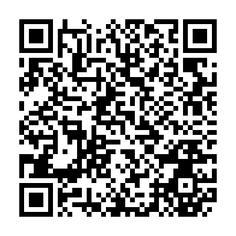

# 젤다의전설 이상한모자 3DS 한글판

A fork of [EstebanPdN/zelda-tmc-3ds](https://github.com/EstebanPdN/zelda-tmc-3ds), adapted to run Korean-patched GBA ROMs on Nintendo 3DS.

The original native 3DS port is the work of Esteban PDN and contributors. This fork adds Korean ROM compatibility; it does not create or distribute the original game or the Korean translation.

## 사용법

**테스트한 한글 패치: stygia v1.1 (2026-11-09)**

ROM과 한글 패치는 각자 준비해서 적용해 주세요. 이 저장소와 릴리스에는 포함되어 있지 않습니다.

1. [릴리스의 CIA](https://github.com/Park-ing-lot/zelda-tmc-3ds-korean/releases/latest)를 FBI로 설치합니다. 아래 QR은 **FBI → Remote Install → Scan QR Code**에서 읽으면 됩니다.
2. 한글 패치한 `.gba` 파일을 SD 카드의 다음 폴더에 넣습니다. 파일명은 자유입니다.

   ```text
   /3ds/The Minish Cap 3DS Korean/
   ```

3. HOME 메뉴에서 실행합니다.



업데이트할 때는 새 CIA를 기존 앱 위에 설치하면 됩니다. 저장 파일은 같은 폴더의 `tmc_jp.sav`를 계속 사용하므로 삭제하지 마세요.

## Credits

- **Nintendo / Capcom** — the original game.
- **[Esteban PDN and contributors](https://github.com/EstebanPdN/zelda-tmc-3ds)** — the original native 3DS port.
- **[samyost1/tmc-android](https://github.com/samyost1/tmc-android)**, **[Project Picori](https://github.com/999sian/tmc)** and **[zeldaret/tmc](https://github.com/zeldaret/tmc)** — source projects credited by upstream.
- **ipatix and agbplay contributors** — audio library.
- **[Francine](https://blog.naver.com/rnslek89/96659349)** — the earlier Korean fan translation.
- **stygia** — the updated Korean patch v1.1 and its translation, font and gameplay fixes, credited in the supplied patch tool.
- **Park-ing-lot / this fork** — Korean ROM compatibility changes, developed with assistance from Codex.

## Build

Uses upstream's devkitPro/devkitARM and 3DS build setup:

```sh
./platform/3ds/build.sh
```

[GitHub Actions builds](https://github.com/Park-ing-lot/zelda-tmc-3ds-korean/actions) · [Development notes](docs/KOREAN_K09_PATCH.md) · [Original upstream README](docs/UPSTREAM_README.md)

Original history and license notices are preserved. Port contributions are under **GPL v3.0 or later**; third-party components retain their licenses. See [LICENSE](LICENSE), [COPYRIGHT.md](COPYRIGHT.md) and [THIRD-PARTY-LICENSES.md](THIRD-PARTY-LICENSES.md).
