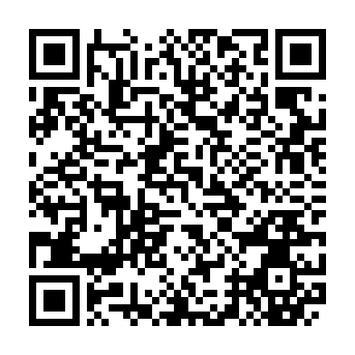

# 한글판 설치·사용 방법

이 프로젝트는 [EstebanPdN의 The Minish Cap 3DS 포트](https://github.com/EstebanPdN/zelda-tmc-3ds)를
기반으로, 기존 한글 패치 ROM이 실행되도록 수정한 비공식 포크입니다.
원작은 Nintendo/Capcom, 기존 한글 번역은 Francine, 최신 v1.1 한글 패치는 stygia의 작업입니다.

**ROM과 한글 패치는 제공하지 않습니다. 각자 정당하게 확보한 일본판 ROM과
패치 제작자의 도구로 한글 패치 ROM을 준비해 주세요.**
권장 버전은 한글 패치 **v1.1 (2026-11-09)**입니다.
패치에 필요한 일본판 ROM의 CRC32는 `6CE771A5`, 패치 완료 후 CRC32는 `7073540C`입니다.
다른 버전의 한글 패치 ROM은 인식되지 않을 수 있습니다.

## 설치

FBI를 사용할 수 있는 커스텀 펌웨어 환경의 3DS가 필요합니다.

1. 아래 QR을 PC나 휴대폰 화면에 띄웁니다.
2. 3DS에서 **FBI → Remote Install → Scan QR Code**로 읽고 설치합니다.
3. 준비한 한글 패치 `.gba` 파일을 SD 카드의 다음 폴더에 넣습니다.

   ```text
   /3ds/The Minish Cap 3DS Korean/
   ```

4. HOME 메뉴에서 게임을 실행합니다. ROM 파일명은 자유이며 `game.gba`로 해도 됩니다.



QR은 **v2.2-K0.9 CIA 설치 파일만** 다운로드합니다. ROM이나 한글 패치를 포함하지 않습니다.
QR 설치가 되지 않으면 [릴리스에서 CIA를 다운로드](https://github.com/Park-ing-lot/zelda-tmc-3ds-korean/releases/tag/v2.2-K0.9)하여
SD 카드에 복사한 뒤 FBI에서 직접 설치하세요.

## 업데이트와 저장

새 CIA를 기존 앱 위에 설치하면 됩니다. 기존 앱을 삭제할 필요가 없습니다.
저장 파일은 같은 폴더의 `tmc_jp.sav`를 계속 사용하므로 이 파일과 폴더를 삭제하지 마세요.
ROM 버전을 바꾸기 전에는 이 파일을 PC에도 복사해 두세요.

**K0.9의 개선된 글자 간격은 최신 v1.1 ROM을 함께 사용해야 적용됩니다.**
이전 한글 ROM은 계속 실행되지만 기존 글자 폭과 자동 줄바꿈을 사용합니다.
원본 프로젝트의 자동 업데이트는 비활성화되어 있으며 이 포크의 릴리스로 직접 업데이트합니다.

3DS 포트, 한글 패치 및 이 포크는 각각 별개의 작업입니다.
엔딩까지의 전체 검증과 최신 패치의 한글 이름 입력 기능 이식은 완료되지 않았습니다.
